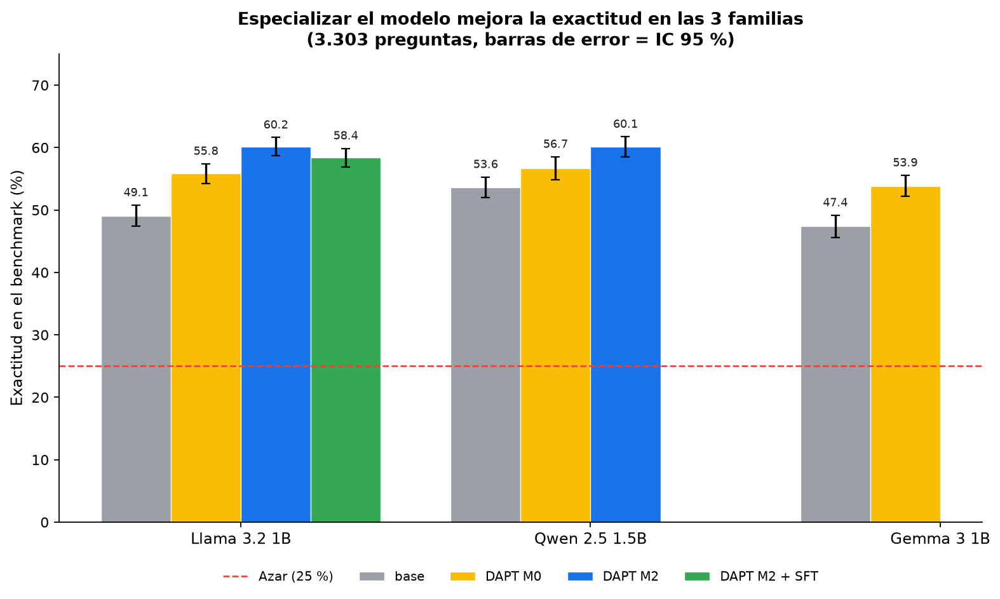
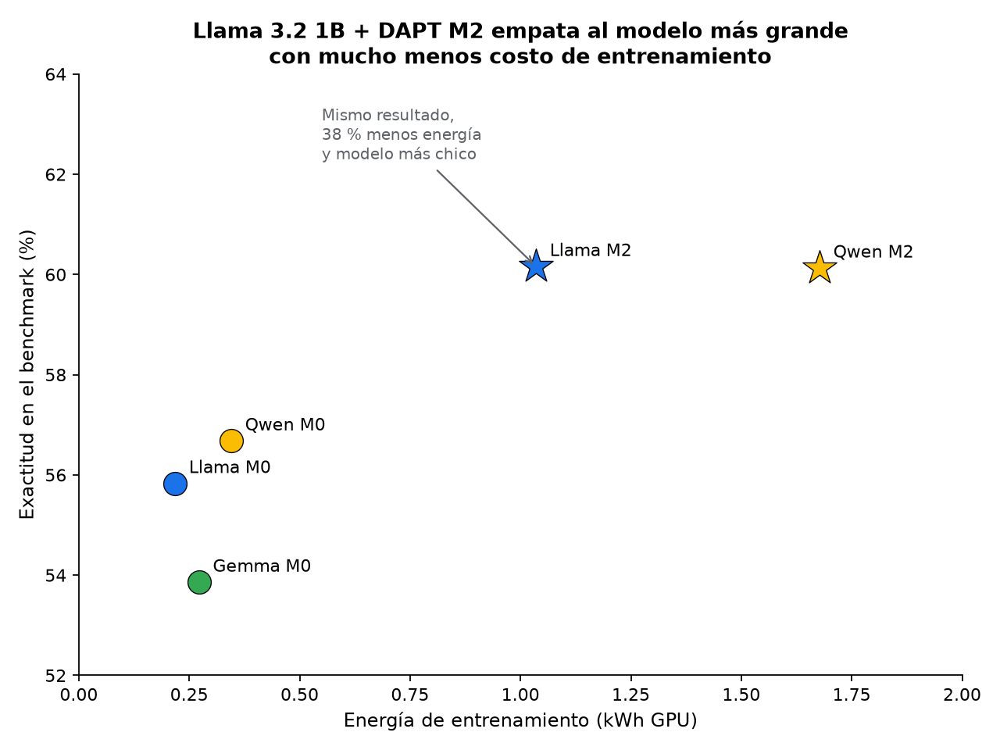

<p align="center">
  
</p>

<p align="center">
  
</p>

<p align="center">
  
  
  
  
  
</p>

> Proyecto de tesis de pregrado: adaptación de modelos de lenguaje pequeños (1–1,5 B parámetros) al dominio
> del maíz (enfermedades foliares, manejo, productos registrados en Colombia y EE. UU.), e integración del
> modelo resultante en una app Android que corre **100 % local, sin internet**, en un celular de gama media
> (6 GB RAM en adelante). Este repositorio cubre la parte de **integración**; el entrenamiento y la minería
> de datos se hicieron en Google Colab / Drive (ver [`colab/`](colab/) y la sección "Pipeline" más abajo).

> **Nota sobre las animaciones de este README:** Markdown de GitHub no ejecuta JS/CSS propio, así que el
> "movimiento" de arriba son imágenes **SVG animadas** servidas por dos proyectos de terceros muy usados en
> READMEs de GitHub — [`capsule-render`](https://github.com/kyechan99/capsule-render) (el encabezado con
> olas) y [`readme-typing-svg`](https://github.com/DenverCoder1/readme-typing-svg) (el texto que se escribe
> solo). Son imágenes externas cargadas en cada visita, no contenido que viva en este repo.

---

## 🔐 Reto 12: Delegando la autenticación

Este repositorio parte de la app del Reto 11 y le agrega inicio de sesión con **GitHub** a través de
**Firebase Authentication**, más un registro de usuarios y planes de uso en **Cloud Firestore**.

**Cómo cumple el reto:**

| Requisito | Cómo se resuelve |
|---|---|
| Proveedor externo de autenticación | GitHub (OAuth), gestionado por Firebase Authentication |
| La app no almacena contraseñas | La app nunca ve la contraseña: solo recibe el uid y el perfil público de GitHub |
| Redirección al servicio del tercero | El botón "Iniciar sesión con GitHub" abre la página de GitHub en el navegador, que pide las credenciales |
| Mensaje de éxito o fallo | Diálogo "Autenticación exitosa" (con el usuario de GitHub) o "Autenticación fallida" (con el motivo: sin Internet, cancelado, rechazado, etc.) |

**Uso de Internet:** solo se necesita para el primer inicio de sesión. Después, la sesión y el registro
del usuario quedan guardados en el teléfono, el modelo sigue corriendo local y el chat funciona sin
conexión. El consumo de tokens se guarda en el teléfono y se envía a Firestore cuando vuelve la conexión.

**Planes** (se cambian desde la consola de Firebase, campo `plan` del usuario):

| Plan | Límite |
|---|---|
| Gratis | 1.000 tokens en total, de prueba |
| Pro | 10.000 tokens por día |
| Ultra Plus | Ilimitado |
| Bloqueado | Sin acceso |

Se cuentan los tokens que genera el modelo en cada respuesta. Si al usuario le quedan menos tokens que el
máximo por respuesta (320), la respuesta se recorta para no pasarse del límite. Al agotarse, la caja de
texto se reemplaza por un aviso con el botón "Ver planes".

**Pago simulado:** todavía no hay cobro. Al solicitar un plan se abre WhatsApp con un mensaje para el
administrador que incluye el usuario de GitHub, el correo y el ID. El administrador cambia el plan en
Firebase. El número se configura en `gradle.properties` (`agroia.whatsappPagos`).

**Puesta en marcha:** sigue [docs/CONFIGURACION_FIREBASE.md](docs/CONFIGURACION_FIREBASE.md) (crear el
proyecto de Firebase, la OAuth App de GitHub, la base de datos, y compilar el APK con GitHub Actions).

**Archivos nuevos o modificados:**

- `data/AuthRepository.kt`: inicio de sesión con GitHub mediante Firebase Auth.
- `data/CuentaRepository.kt`: registro del usuario, plan y consumo de tokens en Firestore, con caché local.
- `domain/Planes.kt`: definición de los planes y cálculo de tokens disponibles.
- `domain/ContactoPagos.kt`: mensaje y enlace de WhatsApp para solicitar un plan.
- `ui/CuentaViewModel.kt`, `ui/CuentaScreens.kt`: pantalla de inicio de sesión, diálogo de resultado,
  barra del plan, aviso de tokens agotados y diálogo "Mi plan".
- `ui/ChatViewModel.kt`, `ui/ChatScreen.kt`, `MainActivity.kt`: control de cuota y menú "Mi plan" / "Cerrar sesión".
- `firestore.rules`: el usuario no puede cambiar su propio plan ni bajar sus contadores.
- `.github/workflows/build-apk.yml`: toma `google-services.json` del repo o de un secret y puede publicar el APK como Release.

**Limitaciones conocidas:** el contador diario del plan Pro usa la fecha del teléfono, así que un usuario
que cambie la fecha podría reiniciarlo. Las reglas de Firestore impiden subirse de plan o bajar el
contador total, pero el control de cuota ocurre en la app. Un cobro real con Google Play Billing o una
pasarela de pagos necesitaría un servidor (por ejemplo Cloud Functions) que valide el pago y cambie el plan.

---

## 💡 Resumen ejecutivo

<p align="center">
  
  
  
  <br/>
  
  
  
</p>

**El problema:** los agricultores de maíz en Colombia y EE. UU. necesitan diagnóstico y manejo de
enfermedades foliares en el campo, donde muchas veces no hay señal. Los chatbots genéricos (GPT, Gemini)
no conocen los registros ICA/EPA, cuestan por consulta y no funcionan sin conexión.

**La propuesta:** un modelo de 1.000 millones de parámetros, 500-1.000× más chico que los modelos de
frontera, especializado con un corpus propio de 41.573 documentos (minado de OpenAlex, DSpace, Europe PMC
y los registros oficiales ICA/EPA), que corre **dentro del teléfono del agricultor**: sin costo por
consulta, sin depender de cobertura, sin exponer los datos del cultivo a un tercero.

**La evidencia, no solo la promesa:**
- El modelo especializado pasó de 49,1 % a 60,2 % de exactitud en un benchmark de opción múltiple de
  3.303 preguntas, con significancia estadística confirmada (prueba de McNemar + corrección de Holm, no
  solo "se ve mejor").
- En la tarea más relevante para el producto — identificar el patógeno o la plaga — la exactitud subió de
  57,7 % a **84,6 %**.
- Empata en precisión con un modelo 50 % más grande (Qwen 2.5 1,5B) gastando **38 % menos energía** de
  entrenamiento, lo que también se traduce en menos cómputo necesario para seguir iterando.
- Cuantizado a 771 MB, cabe y corre en cualquier gama media de 6 GB de RAM en adelante.

**Dónde está parado hoy, con transparencia (así es como un inversionista mide si el equipo es serio):**
el modelo ya corre on-device (Fase 1 completada, ver "Estado actual"), pero antes de un lanzamiento público
faltan tres cosas puntuales y acotadas: (1) verificar con evaluación experta la calidad de las respuestas
sobre el modelo ya cuantizado, (2) un filtro de seguridad para dosis y fuentes citadas (ya detectamos y
documentamos el riesgo concreto, ver "Riesgos conocidos" más abajo), y (3) la app Android terminada. Esa es
la inversión que se busca destrabar.

## 📊 Qué tan bien funciona, con el detalle completo

<p align="center">
  
  
</p>

*(Gráficas generadas con `charts/generar_graficas.py` directamente desde las cifras de `resumen_colab.json`;
el código queda en el repo para regenerarlas si cambian los datos.)*

<details>
<summary><b>Desglose por categoría del benchmark (clic para expandir)</b> — dónde el modelo especializado gana más</summary>

| Categoría | Preguntas | Modelo base | Modelo especializado (M2) | Mejora |
|---|---|---|---|---|
| Patógeno / plaga | 338 | 57,7 % | **84,6 %** | +26,9 pp |
| Enfermedad | 557 | 56,9 % | **67,1 %** | +10,2 pp |
| Cereales relacionados (transferencia) | 932 | 58,8 % | **71,7 %** | +12,9 pp |
| Alcance maíz (específico) | 348 | 52,6 % | 65,2 % | +12,6 pp |
| Ingrediente activo registrado (CO) | 300 | 45,3 % | 59,0 % | +13,7 pp |
| Dosis en maíz (CO) | 347 | 36,0 % | 47,8 % | +11,8 pp |

*(Tabla completa con las 10 categorías, incluidas dos que están por debajo del azar y requieren revisión,
en la sección "Riesgos conocidos".)*

</details>

<details>
<summary><b>Calidad de las respuestas tras el ajuste conversacional — 447 respuestas evaluadas</b></summary>

| Métrica | Valor |
|---|---|
| Cita una fuente | 99,8 % |
| Responde en el idioma pedido | 98,9 % |
| Longitud promedio | 78,9 palabras (se adapta: 55 agricultor → 101 científico) |
| Cifra sin respaldo en la referencia (riesgo) | 9,8 % |

</details>

## 🚦 Estado actual

<p align="left">
  
  
  
  <br/>
  
  
  <br/>
  
  
</p>

## 🏆 El modelo ganador, y por qué

De tres familias entrenadas con DAPT + QLoRA sobre el mismo corpus, **Llama 3.2 1B Instruct + DAPT con la
mezcla M2** es el que se llevó a producción:

| Modelo | Benchmark total | PPL dominio (vs. base) | Costo de entrenamiento |
|---|---|---|---|
| Llama 3.2 1B base | 49,1 % | — | — |
| **Llama 3.2 1B DAPT M2** | **60,2 %** | **−52,0 %** | 14,7 h · 1,03 kWh |
| Qwen 2.5 1.5B DAPT M2 | 60,1 % | −41,9 % | 24,1 h · 1,68 kWh |
| Gemma 3 1B DAPT M0 | 53,9 % | −74,4 %* | 3,9 h · 0,27 kWh |

\* La perplejidad base de Gemma está inflada por un problema de tokenización (falta `<bos>`); no es
comparable directamente. Ver detalle completo en el documento de contexto del proyecto.

Llama M2 empata con Qwen 1,5B (McNemar, p_Holm = 1) siendo más pequeño y con 38 % menos energía de
entrenamiento — la razón por la que es el elegido para correr en un teléfono. Sobre él se hizo el SFT que
usa esta app (`runs/colab_sft_v1_llama32_1b/adapter` en Drive: DAPT M2 + SFT en un solo adaptador LoRA).

<details>
<summary>Alternativas descartadas para la app (clic para expandir)</summary>

- `colab_dapt_llama32_1b_M2/adapter` (sin SFT): benchmark algo mejor (60,2 % vs 58,4 %) pero sin formato de
  chat en 3 niveles ni cita de fuente.
- `colab_dapt_qwen25_15b_M2/adapter`: mismo nivel de precisión, modelo más grande y más lento.

</details>

## 🔄 Pipeline completo

```mermaid
flowchart LR
    A[Minería\nOpenAlex · DSpace · Europe PMC\nPDFs · registros ICA/EPA] --> B[Limpieza + dedup\n+ partición\ncorpus v1: 41.573 docs]
    B --> C[Mezclas de entrenamiento\nM0 / M1 / M2]
    C --> D[DAPT con QLoRA\nColab GPU L4\n3 familias de modelos]
    D --> E[Evaluación\nperplejidad · olvido\nbenchmark · McNemar+Holm]
    E --> F[Selección del modelo final\nLlama 3.2 1B DAPT M2]
    F --> G[SFT\nprofesor Qwen2.5-7B\n3 niveles x 2 idiomas]
    G --> H[Fusión adaptador\n+ GGUF + Q4_K_M]
    H --> I[App Android\nKotlin + llama.cpp/JNI\nchatbot on-device]

    style H fill:#1a73e8,color:#fff
    style I fill:#34a853,color:#fff
```



El código y los datos de entrenamiento viven en Google Drive (`maize_llm_colab/`, `maize_llm/runs/`); no
están en este repositorio porque incluyen artefactos grandes (checkpoints, corpus). El script que fusiona
el adaptador y genera el GGUF cuantizado está en [`colab/preparar_modelo_android.py`](colab/preparar_modelo_android.py)
(pensado para correr como notebook de Colab, celda por celda).

## ⚠️ Riesgos conocidos del modelo (importantes para cómo se construye la app)

Documentados en el proyecto original y confirmados con una prueba real sobre el GGUF ya cuantizado:

- **Las fuentes que cita el modelo pueden ser inventadas.** Ejemplo real observado: ante una pregunta sobre
  la mancha de asfalto del maíz (causada por *Phyllachora maydis*), el modelo citó un artículo sobre
  *Aspergillus flavus* (una enfermedad distinta). El modelo aprendió a terminar con "Fuente: …" de memoria,
  no a partir de un fragmento recuperado. Mitigación recomendada: RAG, mostrando al usuario la fuente
  **recuperada**, no la que el modelo escriba.
- **9,8 % de las respuestas** traen una cifra con unidad (L/ha, kg/ha, g/L, %, días) que no está respaldada
  por la referencia — posible dosis inventada. La app no debe mostrar dosis generadas por el modelo sin
  verificarlas contra el registro ICA/EPA.
- Exactitud de ~60 % en un benchmark de opción múltiple (azar = 25 %): el modelo es un apoyo, no una
  recomendación agronómica definitiva.
- En el nivel agricultor en inglés, 93,3 % de las respuestas salen en el idioma pedido (en el resto de
  combinaciones, 100 %); hay que forzar y verificar el idioma en la app.

## 📁 Estructura de este repositorio

```
colab/      scripts pensados para correr en Google Colab (fusión de adaptador, GGUF, evaluación)
charts/     script de Python que genera las gráficas de este README desde resumen_colab.json
assets/     logo e imágenes
app/        proyecto Android/Kotlin del chatbot (Jetpack Compose)
```

## 📱 La app Android

Kotlin + Jetpack Compose. La inferencia usa un AAR precompilado de llama.cpp
([`llama-android`](https://github.com/ffmpegkit-maintained/llama-android), MIT, Maven Central) en vez de compilar
llama.cpp desde cero con NDK/CMake — menos piezas que pueden fallar en un proyecto académico.

- `domain/SystemPrompts.kt` — las 6 instrucciones de sistema exactas del SFT (idioma × nivel).
- `domain/DoseGuardrail.kt` — detecta cifras con unidad sin respaldar y ausencia de cita de fuente (sección 9.4).
- `data/ModelAssetInstaller.kt` — copia el `.gguf` de los assets del APK a almacenamiento interno la primera vez.
- `data/ModelRepository.kt` — carga el modelo y genera respuestas.
- `ui/` — pantalla de chat (Compose) + `ChatViewModel`.

**Compilación:** el código del Reto 12 se compiló (`assembleDebug`) sin el modelo y con una configuración de
Firebase de prueba; falta probarlo en un celular con el proyecto de Firebase real. Para compilar localmente:

1. Copia tu `maize_llama32_1b_Q4_K_M.gguf` (el que genera `colab/preparar_modelo_android.py`) a
   `app/src/main/assets/models/` (ver `LEEME.txt` en esa carpeta). Ese archivo no está en git —GitHub bloquea
   binarios de más de 100 MB sin Git LFS— así que se queda local en tu copia del repo.
2. Copia tu `google-services.json` a `app/` (ver [docs/CONFIGURACION_FIREBASE.md](docs/CONFIGURACION_FIREBASE.md)).
3. Abre la carpeta raíz del repo en Android Studio y deja que sincronice (instalará el SDK/NDK que falte).
4. Compila y corre en un **celular físico arm64** (el AAR gratuito de llama.cpp solo trae binarios arm64-v8a;
   el emulador estándar x86_64 no va a cargar el modelo).
5. Si Android Studio marca `menuAnchor()` como obsoleto, es un cambio de API menor y seguro de aceptar
   (está documentado en el propio archivo `ui/ChatScreen.kt`).

El tema visual (`ui/theme/Theme.kt`) está en Material 3 neutro a propósito, pendiente de una referencia de
estilo que el autor va a compartir.

## 📜 Licencia del modelo base

El modelo usa `meta-llama/Llama-3.2-1B-Instruct` como base, que requiere aceptar la licencia de Meta en
Hugging Face. El adaptador LoRA entrenado en este proyecto no tiene esa restricción, pero el modelo
fusionado hereda los términos de la licencia de Llama.

<p align="center">
  
</p>
